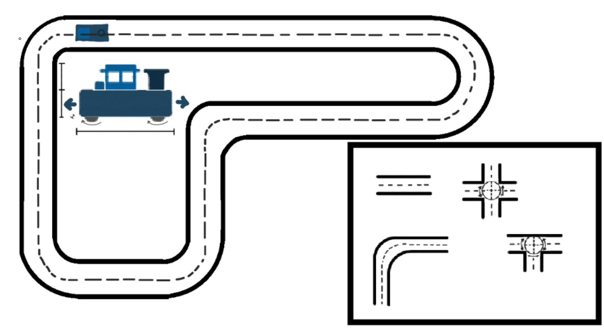
# Model Train - with tracks
### - Description
This ia a project I have been working on for a CAD project for a thing called [Half Life](https://halflife.hackclub.com).
I wanted to do something simpler but yet expandable, thereby not too easy but not too complex.
This is a model train with some different tracks that you can attach to eachother to expand the tracks.

### - What is the meaning
The meaning of this project is mostly to learn and experiment with different tools aswell as putting stuff in perspective.
I am founding these types of projects fun just because you get to push yourself into a deadline, getting something done that you might have not done otherwise.

### - What does this project do
This project's purpose is to show you a little on how a train drives on the tracks. I have tried to follow designs on the wheels as an example.

### - Problems along the way
So with these problems, I have had a little hard trying to understand how the different parts will connect to each other, I would guess that the dimensions were the hardest part.
The train is 32mm x 52mm x 51mm meaning that it is small. The entire train can fit inside your palm and the tracks is just a little wider. Because of this I have had a bit tough finding the points where I need better tolerances than otherwise.
In addition to the other problems, my most anoying problem is that I have had Shapr3D crash on me 5 times without warning be on before hand. As an example my entire screen just became red, fully red from nowhere.

---

### - Train
The train is not very complex. It is a box with a controll room that can be printed by itself and then placed down the sockets. As for the smoke outlet in the front, that one can also be printed and placed down by itself.
The train wheels are slanted inwards giving it a force bonus, meaning that when rolling the wheels can in theory stabilize the train to go straight.
Not only that, the train wheels are also detachable giving you the opertunity to, for example, have them in different colors.
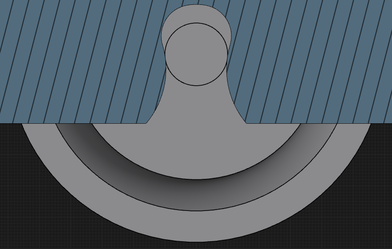
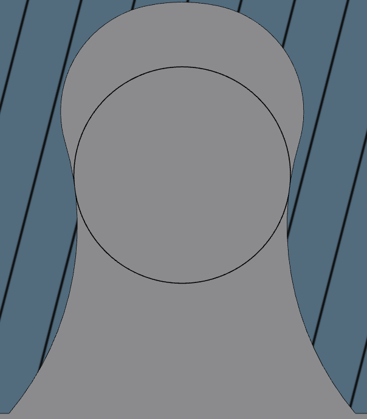
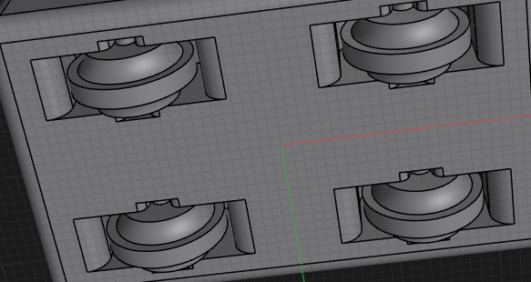
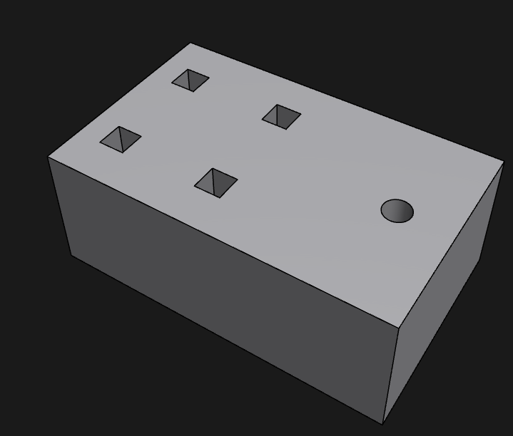
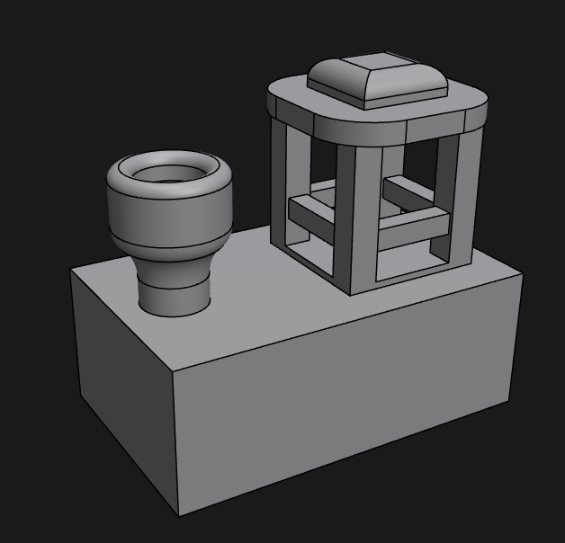
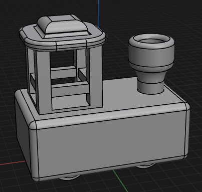
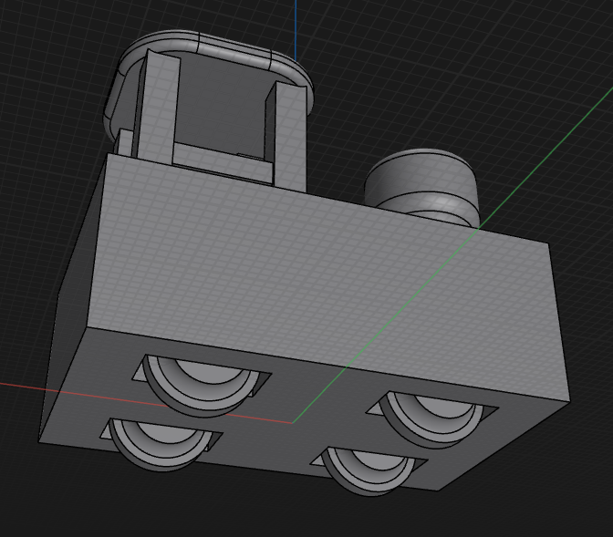

### - Tracks
The tracks are also not too comples. They are built so that the outer part of the track touching the train's wheels are a bit higher then the inner giving you some room for movement. This will come in handy when the train wants to take corners and turn.
The tracks are yousing a quite simple interlocking system. It is simply 2 circles and a bridging in between making the track pieces able to grab around the edges and hold in place.
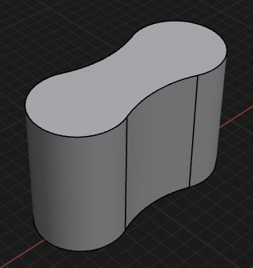
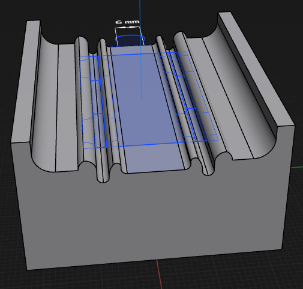
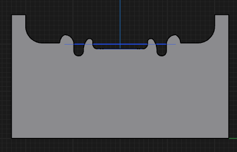
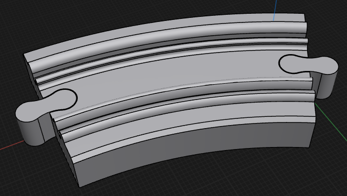
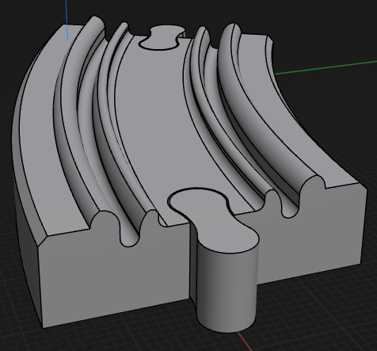
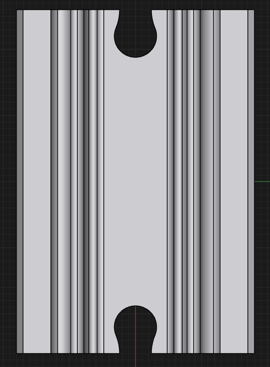
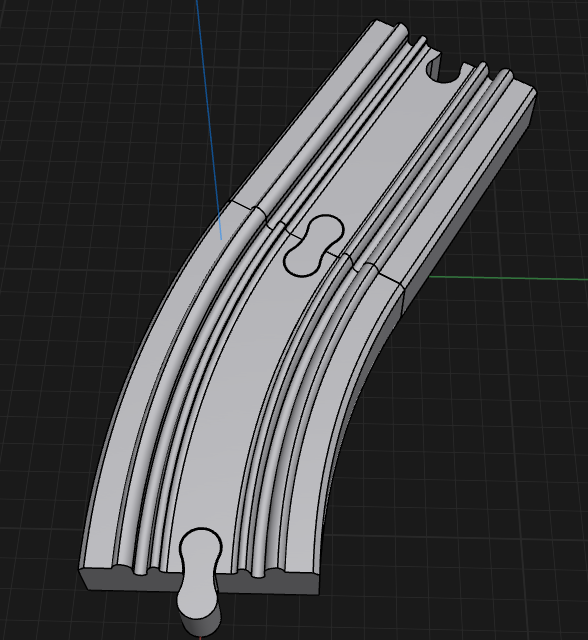

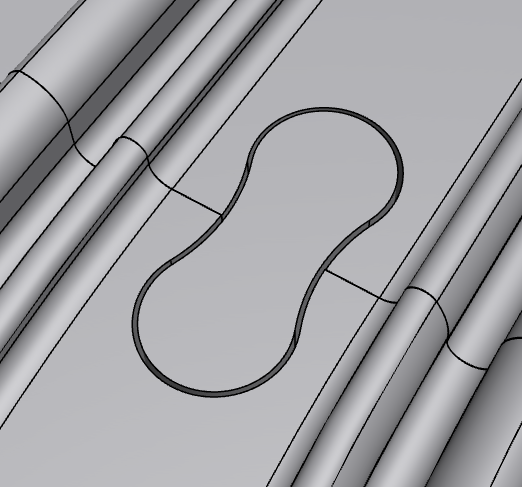

---
### - Build Of Materials
| Item                     | Qty | Supplier   | Cost/item | Total Cost | link                                    |
|--------------------------|-----|------------|-----------|------------|-----------------------------------------|
| 3D Printing              | 1   | West Print | $31.32    | $31.32     | https://www.treatstock.com/c/west-print |
|                          |     |            |           |            |                                         |
| Estimated total shipping | 1   |            |           | $13.42     |                                         |
| TOTAL                    |     |            |           | $44.74     |                                         |
